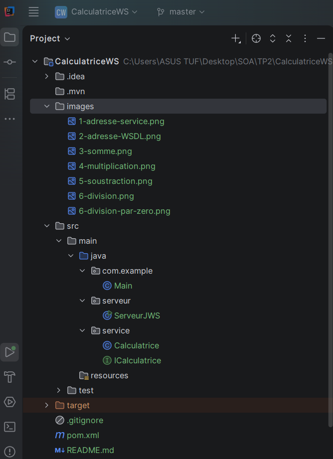
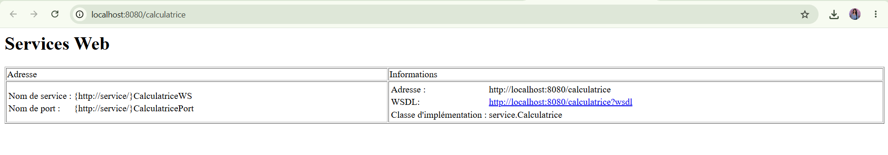
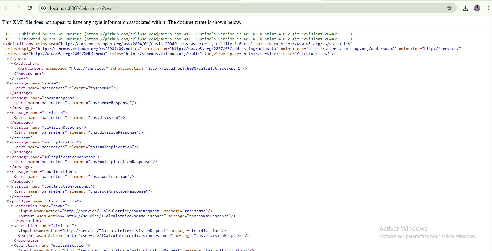
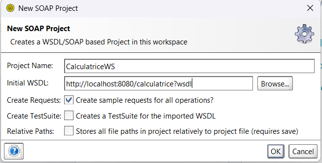
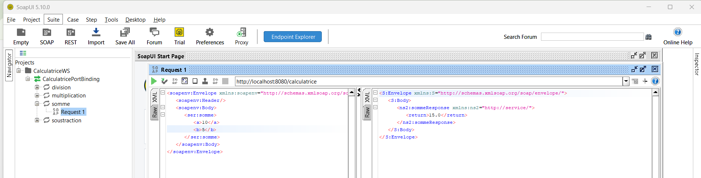
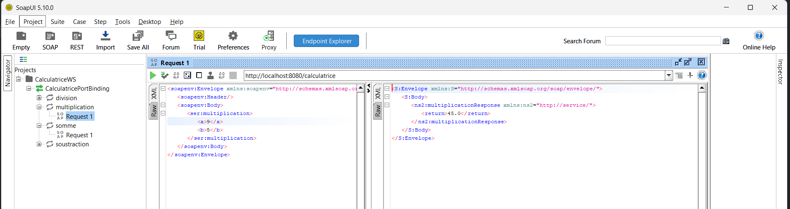
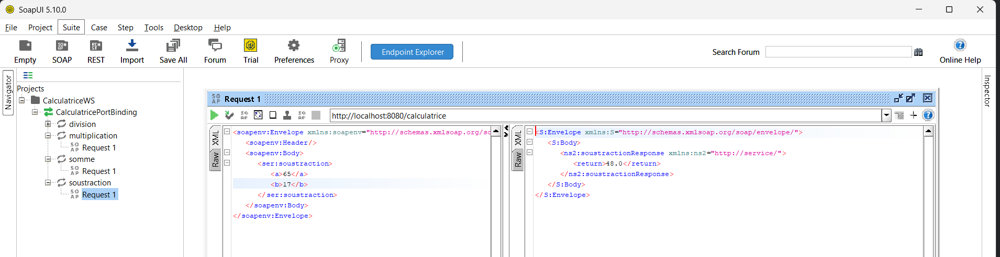
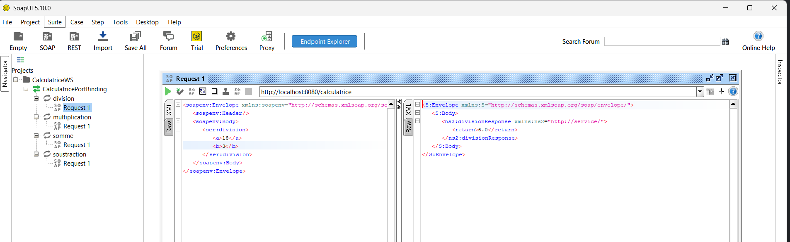
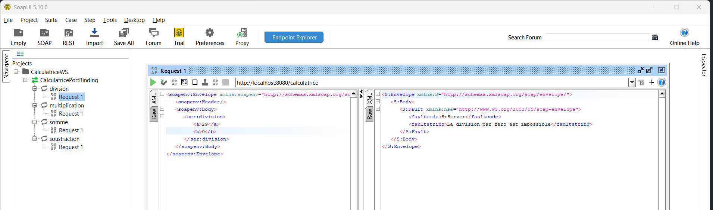

# TP2 — Mise en œuvre de Jakarta XML Web Services (SOAP)

## 1. Présentation du projet

Ce projet est réalisé dans le cadre du TP2 du module **Architecture SOA et Services Web**.

L'objectif est de développer une application Java nommée `CalculatriceWS` qui expose un service web SOAP permettant d'effectuer des opérations mathématiques simples.

Les opérations proposées sont :
- Somme
- Multiplication
- Soustraction
- Division

## 2. Objectifs du TP

Les objectifs de ce travail pratique sont :
- Configurer un projet Maven.
- Ajouter les dépendances nécessaires à Jakarta XML Web Services.
- Créer une interface définissant les opérations du service.
- Implémenter les opérations dans une classe Java.
- Utiliser les annotations Jakarta Web Services.
- Publier le service web SOAP.
- Consulter le WSDL et le XSD générés.
- Tester les opérations avec SOAPUI.

## 3. Environnement de développement

Les outils utilisés pour ce projet sont :
- Java JDK
- IntelliJ IDEA
- Maven
- Jakarta XML Web Services (JAX-WS)
- SOAPUI

## 4. Structure du projet

### Description des fichiers

- **pom.xml** : contient la configuration Maven et les dépendances.
- **ICalculatrice.java** : définit les opérations du service.
- **Calculatrice.java** : contient l'implémentation des opérations mathématiques.
- **ServeurJWS.java** : permet de publier le service web SOAP.

## 5. Configuration Maven

Le projet utilise Maven pour gérer les dépendances nécessaires à la création et à l'exécution du service SOAP.

Les principales dépendances sont :
- `jakarta.xml.ws-api` : API Jakarta XML Web Services.
- `jaxws-rt` : implémentation du runtime JAX-WS.
- `jakarta.jws-api` : annotations pour les services web.

## 6. Interface ICalculatrice

L'interface `ICalculatrice` définit les méthodes disponibles dans le service :
- `somme(a, b)`
- `multiplication(a, b)`
- `soustraction(a, b)`
- `division(a, b)`

Les annotations utilisées sont :
- `@WebService` : déclare le contrat du service web.
- `@WebMethod` : identifie une opération exposée.
- `@WebParam` : définit le nom des paramètres.

## 7. Classe métier Calculatrice

La classe `Calculatrice` implémente l'interface `ICalculatrice` et réalise les opérations mathématiques.

Les calculs utilisés sont :
- Somme : `a + b`
- Multiplication : `a * b`
- Soustraction : `a - b`
- Division : `a / b`

La division par zéro doit être traitée afin d'éviter un calcul invalide.

## 8. Publication du service web

La classe `ServeurJWS` utilise `Endpoint.publish()` pour publier le service web.

Adresse du service :

`http://localhost:8080/calculatrice`

Adresse du WSDL :

`http://localhost:8080/calculatrice?wsdl`

## 9. Tests avec SOAPUI

SOAPUI est utilisé pour envoyer des requêtes SOAP au service et vérifier les réponses obtenues.

Les étapes de test sont :
1. Démarrer le serveur `ServeurJWS`.
2. Créer un projet SOAP dans SOAPUI.
3. Importer le WSDL du service.
4. Sélectionner l'opération à tester.
5. Renseigner les paramètres.
6. Exécuter la requête.
7. Vérifier le résultat retourné.

   

### Exemple : test de la somme
 requête et réponse de l'opération `somme` dans SOAPUI.

requête et réponse de l'opération `multiplication ` dans SOAPUI.

requête et réponse de l'opération `soustraction ` dans SOAPUI.

requête et réponse de l'opération `division` dans SOAPUI.

  test de la `division  par zero`

## 10. Conclusion

Ce TP permet de comprendre les étapes de création d'un service web SOAP en Java avec Jakarta XML Web Services.

Il met en pratique la configuration Maven, la création d'une interface de service, l'implémentation des opérations métier, l'utilisation des annotations Jakarta, la publication du service et les tests avec SOAPUI.

Le projet `CalculatriceWS` illustre ainsi les échanges entre un client et un service web à travers des messages SOAP au format XML.